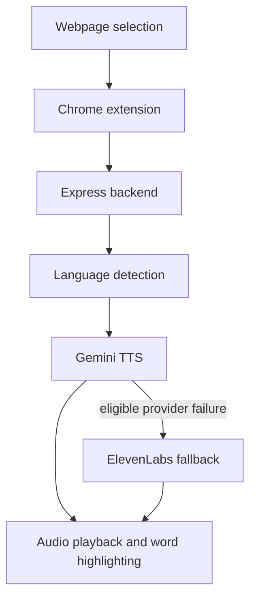

# SelectSpeak

SelectSpeak is a Chrome extension that converts selected webpage text into speech through a Node.js backend. It combines automatic language detection, Gemini TTS, conditional ElevenLabs fallback, approximate word highlighting during playback, playback-speed control, and popup or context-menu interaction. Provider API keys remain in the backend rather than being distributed with the extension.

## Why SelectSpeak

Some users prefer listening to selected content instead of reading it on screen. Browser-native speech quality and language handling can be inconsistent, so SelectSpeak sends selected text to a local backend that detects its language and generates multilingual audio.

## Features

- Reads selected text on normal HTTP and HTTPS webpages from the popup or right-click menu
- Detects the selected text's language with Gemini
- Uses Gemini by default, retries eligible failures, and can fall back to ElevenLabs
- Supports playback speeds from 0.5x to 2.0x plus preview and stop controls
- Highlights selected words approximately as audio progresses
- Keeps provider credentials in the backend and validates input up to 5,000 characters
- Includes automated backend HTTP, provider, and benchmark-statistics tests
- Includes a local live-provider outcome benchmark

## Architecture



The extension communicates with the local Express API and never needs direct Gemini or ElevenLabs credentials. Keeping keys in the backend avoids embedding reusable secrets in extension source that users can inspect.

## Technology stack

| Area | Technology |
|---|---|
| Extension | Chrome Manifest V3, JavaScript, HTML, CSS |
| Backend | Node.js 20+, Express |
| Language detection | Gemini |
| Speech synthesis | Gemini TTS, ElevenLabs fallback |
| Testing | Node test runner, Supertest |
| CI | GitHub Actions |

## Project structure

```text
SelectSpeak/
├── .github/workflows/ci.yml
├── frontend/
│   ├── manifest.json
│   ├── content.js
│   ├── service-worker.js
│   └── popup.{html,js,css}
└── backend/
    ├── app.js
    ├── server.js
    ├── config/
    ├── controllers/
    ├── routes/
    ├── services/
    ├── scripts/benchmark-tts.js
    ├── test/
    ├── .env.example
    └── package.json
```

`frontend/` contains the extension UI, page integration, playback, and highlighting logic. `backend/app.js` creates the Express application, while `backend/server.js` loads configuration and opens the HTTP port. Controllers validate requests, routes map endpoints, and services handle language detection, voice selection, provider retries, and synthesis. `backend/test/` holds offline tests, `backend/scripts/benchmark-tts.js` runs the opt-in live benchmark, and `.github/workflows/ci.yml` runs tests on Node.js 20.

## Prerequisites

- Node.js 20 or newer
- npm
- Chrome or another Chromium-based browser that supports unpacked extensions
- A Gemini API key
- ElevenLabs API credentials and a voice ID only when ElevenLabs is selected or fallback is enabled

## Environment configuration

Copy `backend/.env.example` to `backend/.env`, then replace placeholder values. Do not commit `.env`.

| Variable | Requirement | Purpose and default |
|---|---|---|
| `GEMINI_API_KEY` | Required | Authenticates Gemini language detection and Gemini TTS |
| `GEMINI_TEXT_MODEL` | Optional | Language model; defaults to `gemini-3.5-flash` |
| `GEMINI_TTS_MODEL` | Optional | Speech model; defaults to `gemini-3.1-flash-tts-preview` |
| `GEMINI_TTS_VOICE` | Optional | Gemini voice; defaults to `Kore` |
| `TTS_PROVIDER` | Optional | Primary provider; defaults to `gemini` |
| `TTS_FALLBACK_PROVIDER` | Optional | Fallback provider; defaults to `elevenlabs` |
| `ELEVENLABS_API_KEY` | Conditional | Required when ElevenLabs can be used |
| `ELEVENLABS_VOICE_ID` | Conditional | Default ElevenLabs voice when ElevenLabs can be used |
| `ELEVENLABS_MODEL_ID` | Optional | Defaults to `eleven_multilingual_v2` |
| `PORT` | Optional | Backend HTTP port; defaults to `3000` |

Gemini configuration is required because language detection always uses Gemini. With the frontend's `auto` provider choice, the backend uses `TTS_PROVIDER` first and `TTS_FALLBACK_PROVIDER` second. Gemini receives at most two attempts; fallback occurs only after eligible 429 or 5xx failures, not after ordinary client errors.

## Local installation

```bash
git clone https://github.com/KayDo214/SelectSpeak.git
cd SelectSpeak/backend
npm install
cp .env.example .env
npm start
```

Edit `.env` with your own credentials before starting the backend. On Windows, copy `.env.example` manually or run `Copy-Item .env.example .env` in PowerShell.

## Loading the Chrome extension

1. Start the backend.
2. Open `chrome://extensions`.
3. Enable **Developer mode**.
4. Select **Load unpacked**.
5. Choose the repository's `frontend` directory.
6. Open a normal HTTP or HTTPS webpage.
7. Select some text.
8. Use the SelectSpeak popup or the right-click context menu.

Chrome blocks extension scripts on protected pages, including `chrome://` pages and the Chrome Web Store.

## Usage

For popup playback, select webpage text, open SelectSpeak, adjust the speed if needed, and choose **Speak Selected Text**. The popup detects the language before requesting speech; **Preview Voice** generates a short language-specific sample, and **Stop Reading** stops popup or page audio.

For context-menu playback, select text, right-click it, and choose **Read selected text**. Audio plays in the page at the saved speed. During page playback, SelectSpeak estimates the current word from elapsed audio progress; it does not receive word timestamps from the provider.

## API reference

| Method | Endpoint | Purpose |
|---|---|---|
| GET | `/health` | Backend health check |
| POST | `/api/analyze` | Detect selected-text language |
| POST | `/api/tts` | Generate speech audio |
| GET | `/api/voices` | Return available voices |

Language request:

```json
{ "text": "Bonjour tout le monde" }
```

Speech request:

```json
{
  "text": "Hello from SelectSpeak.",
  "preferences": { "provider": "auto", "voiceName": "Kore" }
}
```

Successful speech responses are audio and include `X-TTS-Provider` plus detected-language headers. `/api/voices` always includes configured Gemini voices and adds ElevenLabs voices when ElevenLabs credentials are available.

## Available scripts

Run these commands from `backend/`.

| Command | Purpose |
|---|---|
| `npm run dev` | Start the backend with Nodemon reloads |
| `npm start` | Start the backend normally |
| `npm test` | Run the offline automated test suite |
| `npm run benchmark:tts` | Run the local live-provider benchmark |

## Testing

```bash
cd backend
npm test
```

The current suite passes 14 tests: functional HTTP behavior, input validation, deterministic provider retry/fallback behavior, and benchmark calculations. Provider calls are replaced with test doubles, so tests require no API keys and consume no paid provider quota.

## Benchmark

Start the backend:

```bash
cd backend
npm start
```

Then run the benchmark from another terminal:

```bash
cd backend
BENCHMARK_REQUESTS=10 npm run benchmark:tts
```

The benchmark reports success and error rates; mean, p50, and p95 latency; minimum and maximum latency; completed requests per minute; average successful-response size; and final provider distribution. It uses the nearest-rank percentile algorithm: sort latencies and select rank `ceil(percentile / 100 × count)`. A warning is shown when fewer than 20 requests make p95 unstable.

Configuration variables are `BENCHMARK_BASE_URL` (default `http://localhost:3000`), `BENCHMARK_REQUESTS` (`10`), `BENCHMARK_WARMUP` (`1`), `BENCHMARK_CONCURRENCY` (`1`), `BENCHMARK_TIMEOUT_MS` (`60000`), and `BENCHMARK_TEXT` (a fixed short English sentence). Warm-up requests are excluded. Only 2xx responses succeed, and provider percentages describe final successful-response providers rather than inferred fallback events.

Automated tests use mocks; the benchmark sends requests to configured live providers. Larger runs consume more provider quota. Its output is labeled **Local live-provider benchmark, not production traffic**, and results depend on the local environment.

## Security and privacy

- Provider API keys remain in the backend and must not be committed.
- Selected text is sent to the local backend and then to configured external AI providers.
- The extension does not require direct provider credentials.
- A public deployment would need additional controls such as restricted CORS, authentication, rate limiting, and managed secrets.

## Current limitations

- The backend must currently be running locally.
- External provider availability and quotas affect synthesis.
- Protected browser pages cannot be accessed.
- Word highlighting is approximate and follows playback progress rather than provider word timestamps.
- Benchmark results vary with the network, machine, text length, concurrency, and provider.

## Focused roadmap

1. Deploy the backend with authentication and rate limiting.
2. Use real speech timestamps for accurate word synchronization.
3. Package and prepare the extension for Chrome Web Store submission.

## Repository status and license

SelectSpeak is a student project intended for local development and demonstration. Continuous integration runs the backend tests, but no release or deployment workflow is included. The repository currently has no standalone `LICENSE` file, so no open-source license is claimed here.
